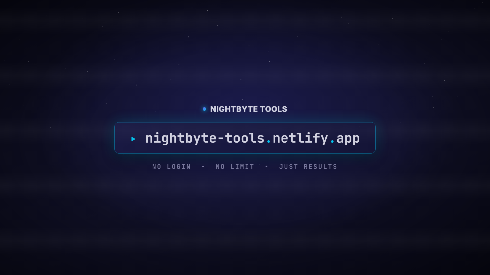

  

# NightByte Tools

<strong>No login. No limit. Just results.</strong>

  <a href="https://nightbyte-tools.netlify.app"><strong>Open the live site &rarr;</strong></a>

---

https://raw.githubusercontent.com/vk-dev01/nightbyte-tools/main/demo.mp4

<em>Silent 3D showcase — loops seamlessly. Click play.</em>

---

## What this is

A collection of **free browser-based tools** for gamers and everyday tasks —
BGMI and Free Fire sensitivity calculators, TTK and damage maths, plus a full
set of PDF utilities. Everything runs client-side. No account, no sign-up,
no payment, no upload.

## Gaming tools

| Tool | What it does |
|---|---|
| [BGMI Sensitivity Code Generator](https://nightbyte-tools.netlify.app/bgmi-sensitivity-code-generator.html) | Device-based sensitivity values |
| [Free Fire Sensitivity Settings](https://nightbyte-tools.netlify.app/ff-sensitivity-generator.html) | Headshot-friendly FF settings |
| [Free Fire Damage Calculator](https://nightbyte-tools.netlify.app/ff-damage-calculator.html) | Gun damage maths |
| [BGMI TTK Calculator](https://nightbyte-tools.netlify.app/bgmi-ttk-calculator.html) | Time-to-kill by weapon |
| [BGMI KD Calculator](https://nightbyte-tools.netlify.app/bgmi-kd-calculator.html) | K/D tracking |
| [eDPI Calculator](https://nightbyte-tools.netlify.app/edpi-calculator.html) | Mouse DPI x sensitivity |
| [Crosshair Generator](https://nightbyte-tools.netlify.app/crosshair-generator.html) | Custom crosshair presets |
| [PC Build Calculator](https://nightbyte-tools.netlify.app/pc-build-calculator.html) | Budget PC in seconds |
| [Pro Player Settings](https://nightbyte-tools.netlify.app/pro-player-settings.html) | Pro player configs |
| [Sensitivity Converter](https://nightbyte-tools.netlify.app/sensitivity-converter.html) | Convert between games |

Plus 30+ general utilities: health, BMI, age, BMI, loan, fuel efficiency,
unit and temperature converters, percentage, tip, password generator, colour
picker, JSON formatter, regex tester, text diff, QR codes, image compressor,
hash generator, text to speech, resume builder, invoice generator and more.

## PDF tools

All processed in the browser — your files never leave your device.

| Tool | What it does |
|---|---|
| [Merge PDF](https://nightbyte-tools.netlify.app/pdf-tools/merge-pdf) | Combine PDFs |
| [Split PDF](https://nightbyte-tools.netlify.app/pdf-tools/split-pdf) | Extract pages |
| [Compress PDF](https://nightbyte-tools.netlify.app/pdf-tools/compress-pdf) | Reduce file size |
| [PDF to JPG](https://nightbyte-tools.netlify.app/pdf-tools/pdf-to-jpg) | Convert to images |
| [JPG to PDF](https://nightbyte-tools.netlify.app/pdf-tools/jpg-to-pdf) | Images into a PDF |
| [Redact PDF](https://nightbyte-tools.netlify.app/pdf-tools/pdf-redact) | Remove sensitive text |
| [Sign PDF](https://nightbyte-tools.netlify.app/pdf-tools/pdf-signature) | Add your signature |
| [Watermark PDF](https://nightbyte-tools.netlify.app/pdf-tools/watermark-pdf) | Stamp a watermark |
| [Rotate PDF](https://nightbyte-tools.netlify.app/pdf-tools/rotate-pdf) | Change orientation |
| [PDF Health Score](https://nightbyte-tools.netlify.app/pdf-tools/pdf-health-score) | Check structure and metadata |

## Why it is built this way

- **104 pages**, each with hand-written unique content — no thin or duplicated pages
- **Client-side processing** for all PDF and image work — files never uploaded
- **Static build**, served from a global CDN
- **Accessible** — keyboard navigable, labelled controls, reduced-motion respected
- **No dark patterns** — no forced signup, no interstitials, no fake download buttons

## Try it

### <https://nightbyte-tools.netlify.app>

---

  Made by <strong>VK | Vibe Coder</strong> &nbsp;&middot;&nbsp; NightByte Tools &copy; 2026

